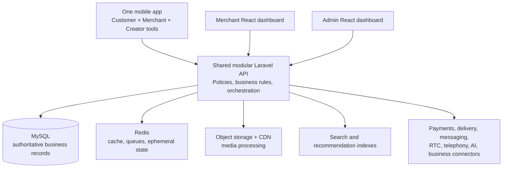

# Segno Gebeya — architecture, coverage, design gaps, and implementation plan

**Status:** Overall plan approved by the user on 2026-11-04.
**Implementation status:** Not started. Screen designs and implementation milestones retain their separate approval gates. Approval of this plan does not authorize application implementation.

## 1. Summary and evidence

Segno Gebeya will retain the approved architecture: **one mobile application with customer and merchant modes, separate merchant and admin React dashboards, and a shared modular Laravel/MySQL backend**.

The user's answers establish these planning decisions:

- **First public release:** the entire blueprint, including advanced commerce, AI telephone support, future capabilities, integrations, and optional monetization.
- **Delivery:** small internal milestones; public release waits for the complete agreed scope.
- **Design approval:** approve each milestone's screens and workflows before implementing that milestone.
- **Launch market:** Ethiopia.
- **Initial interface languages:** Amharic and English.
- **Partners:** no fixed payment, delivery, telephone, or business-software partners.
- **Proposed default:** ETB settlement. This remains a recorded assumption until confirmed during market configuration.

**Sources inspected**

The planning investigation read [AGENTS.md](AGENTS.md), the [planning prompt](docs/prompts/PLAN_MODE_PROMPT.md), the complete [master requirements](docs/requirements/MASTER_REQUIREMENTS.md), the complete [design brief](docs/design/MASTER_DESIGN_BRIEF.md), the [screen index](docs/design/SCREEN_INDEX.md), and [README](README.md), and visually inspected all 11 PNG boards in [docs/design/images/](docs/design/images/).

All requested project sources were readable.

**Repository state at planning**

- Documentation and reference images only.
- No application implementation, manifests, lockfiles, migrations, tests, or reusable application components.
- No Git repository is initialized.
- The atlas contains **180 numbered mobile concepts** across boards 02–11. Board 01 adds foundations and eight overview examples; these are not eight additional validated workflows.
- No existing mobile framework needs preservation.

Available tools include PHP 8.3, Composer, Node 20, pnpm, Docker CLI, Git, and Android platform tools. Their presence does not establish that databases, containers, emulators, or release builds work. Node 20 is now listed as end-of-life, so the implementation foundation should use a supported LTS runtime compatible with the selected mobile SDK. [Node.js release schedule](https://nodejs.org/en/about/previous-releases)

**Source conflicts resolved**

The preserved design brief requests approval of the entire design package before coding, while the requirements also describe progressive module approval. The user's selected **per-milestone approval** model governs the plan. Future designs remain unapproved until reviewed; approving this architecture does not approve unfinished screens.

The source roadmap is reordered to prove tagged discovery and commerce early. No capabilities are removed: later milestones still precede the first public release.

The initial planning investigation was read-only: no files were modified, dependencies installed, applications scaffolded, or databases changed. No application tests could be run because no implementation existed. This approved plan is subsequently being saved at the user's explicit request.

## 2. Experience architecture and missing-design report

**Navigation**

| Experience | Navigation and boundaries |
|---|---|
| Customer mobile | Home, Explore, Reels, Shop, Profile. Messages, notifications, and cart remain persistent contextual actions. |
| Customer account | Orders, addresses, payment methods, wishlist, collections, rewards, referrals, privacy, security, and settings. Private account information appears only to its owner. |
| Merchant mobile | Overview, Products, Create, Orders, More. More contains inventory, customers, inbox, promotions, earnings, analytics, staff, and settings. Show the active store and Merchant mode clearly. |
| Creator tools | A permission-controlled Creator studio within the same mobile identity: opportunities, affiliate catalogue, content, campaigns, attribution, earnings, and payouts. |
| Merchant web | Store-aware sidebar, operational tables, bulk actions, content workspace, fulfilment, finance, analytics, staff, and settings. |
| Admin web | Role-specific queues and navigation for marketplace operations, moderation, finance, support, AI administration, security, and configuration. |

Mode switching changes navigation and working context. It never grants permissions. Switching stores must also refresh store-scoped data and subscriptions.

**Connected journeys**

| Journey | Required path |
|---|---|
| Customer purchase | Sign in → tagged feed content → select product → details → variant → cart → checkout → verified payment result → order → merchant fulfilment → customer tracking. |
| After purchase | Delivered order → eligible verified review → eligible reward → ledger entry; cancellation, return, and refund branches reverse applicable benefits. |
| Merchant activation | Apply → submit verification → information request/approval → configure store, fulfilment, and settlement → publish product → publish tagged content. |
| Social discovery | Follow → feed/reel/story → product tag → discussion or merchant conversation → purchase without losing discovery context. |
| Creator commerce | Apply/join → accept partnership terms → publish disclosed promotion → attributed purchase → commission eligibility → statement and payout. |
| AI support | AI disclosure → language selection → public assistance or identity verification → authorized lookup → action proposal → confirmation → backend result → human handoff when needed. |
| Administration | Review queue → inspect permitted evidence → decision with reason → notification → appeal, financial adjustment, or audit follow-up. |

**Design system direction**

Preserve the references' ivory/white surfaces, deep teal actions, dark green text, restrained lime accents, warm photography, and clear distinction between social discovery and transactional work.

Use these as **candidate foundation tokens**, subject to milestone-zero approval:

| Token | Proposed value or rule |
|---|---|
| Light canvas / surface | `#F5F5EF` / `#FFFFFF` |
| Primary action | `#126C55`, with white text |
| Primary text | `#152B26` |
| Accent | `#D9EF72`, with dark text |
| Dark canvas | `#0E221F`; derive separate accessible dark-surface and action tokens |
| Typography | Inter for Latin text, with a compatible Ethiopic family such as Noto Sans Ethiopic; verify shaping, weights, line height, and fallback |
| Body size | 16 logical pixels by default; support system text scaling |
| Spacing | 4, 8, 12, 16, 24, 32 |
| Corners | 12, 16, 24, assigned by component purpose |
| Touch targets | Target at least 48 logical pixels for mobile controls |
| Motion | Brief functional transitions, reduced-motion alternatives, no required gesture-only action |

Calculated contrast for these candidate pairs is approximately **6.36:1** for white on primary teal, **13.65:1** for dark text on ivory, and **11.77:1** for dark text on lime. White on lime is only **1.27:1**, so it must not be used for readable text. These calculations are not a completed accessibility audit. Target WCAG 2.2 AA for web and equivalent native usability, including keyboard, screen-reader, focus, contrast, and text-scaling checks. [WCAG 2.2](https://www.w3.org/TR/WCAG22/)

Build reusable buttons, forms, money displays, merchant identity blocks, product cards, accessible product tags, video controls, story components, sheets, dialogs, tables, filters, status timelines, ledger views, uploaders, and feedback states. Mobile and web share semantic tokens and contracts; each uses appropriate native or browser components.

**Actual gaps and inconsistencies**

| Finding from the inspected boards | Required design work |
|---|---|
| No merchant desktop or admin desktop boards | Design both dashboards explicitly, including desktop and tablet navigation, tables, bulk work, drawers, permissions, and financial operations. |
| Boards are static concepts | Specify transitions, validation, back navigation, deep links, interrupted tasks, and state ownership. Create prototypes for critical journeys. |
| Generic “Social Commerce” branding remains | Apply Segno Gebeya consistently; create approved app icon, wordmark, launch assets, and brand usage rules. |
| Board 05:14 depicts card-number/CVV fields | Replace with provider-hosted checkout or approved tokenized SDK components. Platform forms must not collect raw card details. |
| Board 05:18 asserts no charge after failure | Add pending/unknown/reconciliation states. Make financial claims only when provider verification supports them. |
| Board 06:11 presents earning on order placement | Distinguish pending and available rewards; explain eligibility, limits, budgets, and reversal conditions. |
| Board 07:07–08 shows 328/300 participants alongside remaining slots | Specify campaign thresholds, capacity, oversubscription, deadline, stock, and payment outcomes from backend truth. |
| Board 04:06 places review-like content within discussion | Keep comments and verified reviews in separate systems and clearly identified views. |
| Board 09:05 includes “Allow reviews” | Define platform-controlled review rights so merchants cannot suppress eligible negative feedback. |
| Board 11:02 combines waitlisting, reservation, and stock confirmation | Design these as distinct states. Joining a waitlist must not imply reserved stock. |
| Board 08:14 primarily shows app-based verification | Add telephone-only verification, failed verification, inaccessible SMS, human recovery, transfer failure, and out-of-hours support. |
| Board 11 shows one dark feed and a state gallery | Extend dark mode and relevant states across all mobile and web modules. |
| Profile/public account boundaries are incomplete | Design visitor versus owner views, collection access, blocked accounts, deletion/export, and staff access restrictions. |
| Ethiopia localization is absent | Design Amharic text expansion, Ethiopic typography, localized addresses and money, translated errors, bilingual policies, and native-speaker review. |
| Future business and integration interfaces lack references | Design subscriptions, entitlements, billing, connector setup, import mapping/errors, warehouses, stock synchronization, partner credentials, and webhook delivery history. |
| Complex operational cases are missing | Add partial refunds, split-payment failures, partial shipments, return inspection, payout holds, moderation appeals, commission reversals, and concurrent edits. |

Every relevant screen must cover default, loading, empty, validation error, service error, offline, permission-denied, disabled, selected, confirmation, pending, success, and recovery states. Success must follow confirmed system state.

Responsive dashboards must adapt information density and actions to available space. They must not stretch mobile artboards. Product hotspots need an accessible product-list alternative; video needs captions and playback controls; location and media permissions need manual alternatives.

## 3. Technical architecture, business rules, and integrations

**Application structure**

```text
segno-gebeya/
  apps/
    mobile/                 React Native + Expo, customer and merchant modes
    merchant-web/           React + TypeScript + Vite
    admin-web/              React + TypeScript + Vite
  services/
    api/                    Modular Laravel application
    voice-gateway/          Streaming/SIP transport when required
  packages/
    contracts/              OpenAPI-derived TypeScript contracts
    design-tokens/          Shared semantic tokens
    ui-web/                 Shared browser components
    localization/           Shared translation resources
  infrastructure/           Local services, deployment and monitoring
  docs/                     Preserved references and approved project memory
```

Recommend **React Native with Expo development builds** because there is no existing framework, it aligns with React/TypeScript web development, and it supports the native media and communication integrations this product needs. The tradeoff is continued native build, device, SDK, and app-store work. Use development builds for native integration validation; Expo documents support for custom native libraries through this workflow. [Expo development builds](https://docs.expo.dev/develop/development-builds/introduction/)

Use Laravel 13 as the proposed backend baseline, with a supported patched PHP runtime and locked dependencies. Laravel 13 requires PHP 8.3 or newer. [Laravel release policy](https://laravel.com/docs/13.x/releases)



Keep business ownership in Laravel. Media workers, RTC infrastructure, search indexes, and the voice gateway are supporting infrastructure, not independent commerce backends.

**Backend modules and main entities**

| Domain | Main entities and responsibilities |
|---|---|
| Identity and stores | Users, profiles, roles, permissions, store memberships, verification records, devices, sessions, consent, audit records. |
| Catalogue and inventory | Products, variants, attributes, categories, brands, media, warehouses, stock movements, reservations, price history. |
| Social and discovery | Posts, reels, stories, live sessions, product tags, comments, follows, likes, reposts, saves, reports, feed events. |
| Commerce | Carts, checkout quotes, checkout groups, merchant orders, immutable order lines, payment attempts, invoices, refunds, disputes. |
| Fulfilment | Shipping methods, shipments, shipment items, tracking events, delivery addresses, returns, inspections, restocking. |
| Growth and finance | Campaigns, coupons, reward ledger, referrals, affiliate touches and commissions, merchant balances, settlements, payouts, subscriptions, entitlements. |
| Communication | Conversations, participants, messages, attachments, call sessions, notifications, support tickets and assignments. |
| AI and operations | Agents, approved tools, knowledge sources, conversations, action confirmations, action logs, evaluations, escalations, analytics events, integration deliveries. |

Products remain independent of content. A reusable product tag connects a product to a media asset and, where relevant, normalized image coordinates or video time ranges. Archived or unavailable products remain identifiable in historical content without appearing purchasable.

**API and access contracts**

- Versioned REST API under `/api/v1`, documented with OpenAPI.
- Customer, merchant, and admin route groups call shared domain services.
- Typed contracts cover money, products/variants, tags, checkout quotes, orders, payment attempts, shipments, ledgers, and AI action proposals.
- Server-calculated prices, eligibility, inventory, fees, tax, and permissions are authoritative.
- Consistent validation errors, pagination, filtering, request identifiers, rate limits, and conflict responses.
- Explicit commands for consequential transitions—such as dispatch, cancellation, refund approval, and payout—rather than arbitrary status editing.
- Use idempotency keys for checkout submission, payments, refunds, redemptions, commissions, payouts, and consequential AI execution.
- Realtime events contain identifiers and safe updates; clients refetch authorized records after reconnection.

Use Laravel Sanctum for first-party authentication: secure cookie sessions for web and expiring, revocable per-device tokens for mobile. Sanctum supports both SPA and mobile authentication. Web deployment must satisfy its domain requirements or use same-origin API reverse proxies. [Sanctum authentication](https://laravel.com/docs/13.x/sanctum)

Require backend ownership policies on every store, product, order, conversation, media asset, and financial record. Admin authentication needs a separate elevated session and MFA. Merchant staff permissions are store-scoped; finance, moderation, support, and administration are distinct privileges.

**Commerce state model**

| Record | Required transitions |
|---|---|
| Payment attempt | Created → pending → succeeded, failed, or expired. Unknown outcomes stay pending investigation until verified. Refunds are separate records. |
| Merchant order | Pending payment → confirmed → processing → packed → fulfilment/completion. Cancellation and dispute branches use eligibility checks. |
| Shipment | Pending → ready → shipped → out for delivery → delivered, with exception, failed-delivery, and return branches. |
| Return | Requested → approved/rejected → return in transit → received → inspected → closed. |
| Refund | Requested → approved/rejected → processing → succeeded or failed; provider acceptance is not completed reimbursement. |
| Rewards/commission | Pending → eligible/available → redeemed or paid, with expiry, reversal, and adjustment entries. |

Order summaries derive from their merchant orders and shipments. Payment, fulfilment, returns, and refunds must not be collapsed into one ambiguous status.

**Critical invariants**

- A multi-merchant cart creates a checkout group containing merchant orders and potentially several shipments.
- Money uses integer minor units plus a currency code. Order lines preserve price, tax, discount, merchant, variant, and policy snapshots.
- Checkout quotes have an expiry and are revalidated before submission. Price changes require explicit customer review.
- Cart contents do not reserve stock. Checkout reservations use MySQL transactions and row-level concurrency controls.
- Reservation expiry, payment completion, cancellation, and fulfilment update stock atomically and idempotently.
- A late successful payment after reservation expiry attempts safe stock reacquisition; unavailable stock produces a financial exception and refund workflow.
- Payment redirects never confirm payment. Verify webhook authenticity and independently verify reference, amount, currency, account, environment, and final provider status.
- Store webhook receipts durably, deduplicate processing, and reconcile missing or contradictory events.
- Publish durable business events through a transactional outbox. Dispatch ordinary queued work after commit; Laravel supports after-commit queue dispatch. [Laravel queues](https://laravel.com/docs/13.x/queues)
- Partial returns/refunds allocate discounts, tax, shipping, rewards, and commissions consistently to affected lines.
- Financial and reward ledgers are append-only; corrections use compensating entries.
- Reviews require eligible purchases. Social comments never confer verified-purchase status.
- Reward rules support eligible purchases, reviews, referrals, follows, and campaigns with budgets, limits, deduplication, and abuse controls. Positive ratings are never required.
- Affiliate attribution records its policy version. Proposed default: one eligible creator per order line using a configurable last eligible click window; exclude self-referrals and reverse refunded commissions.
- Group buying uses server time, eligible paid participation, stock controls, and atomic campaign closure. Do not assume payment authorization/capture exists; qualify the funding/refund model first.
- Waitlists, timed stock reservations, and completed orders have different meanings and UI.
- Provider settlements and platform payout records must reconcile without paying merchants twice.

**Infrastructure**

Use MySQL as the source of truth; Redis for caching, queues, presence, and other disposable state. Run separate worker queues for finance, notifications, media, search, AI, and exports, with bounded retries and failed-job review.

Upload media directly to controlled object storage using short-lived authorization. Validate type and size, quarantine unsafe files, process thumbnails/transcodes/captions asynchronously, moderate before publication, and deliver through a CDN. Keep merchant verification documents private.

Use Laravel Reverb/WebSockets for application events and messaging. Use a managed RTC service or LiveKit for audio/video; Laravel authorizes rooms and records calls. LiveKit documents React Native support and SIP integration, but Ethiopian telephone access still requires a qualified number/trunk provider. [LiveKit React Native](https://docs.livekit.io/transport/sdk-platforms/react-native/), [SIP calling](https://docs.livekit.io/telephony/accepting-calls/)

Start search behind a replaceable adapter, with Meilisearch as the initial candidate. Test Amharic retrieval, normalization, transliteration, synonyms, facets, and mixed-language queries before committing. Its documentation does not list dedicated Ethiopic tokenization, so generic multilingual support is insufficient evidence of launch quality. [Meilisearch language support](https://www.meilisearch.com/docs/resources/help/language)

Instrument structured logs, correlation IDs, error tracking, queue delay, payment reconciliation, inventory anomalies, media failures, call quality, and AI tool execution. Redact secrets and sensitive customer data.

**Integration qualification**

| Integration | Proposed approach | Required evidence before production |
|---|---|---|
| Payments and settlements | Chapa is the first sandbox candidate; evaluate provider-hosted local mobile-money, bank, and card flows. | Merchant approval, contracted methods, verified callbacks, partial refunds, settlement timing, commission handling, multi-merchant funding, reconciliation, and failure recovery. |
| Delivery | Support merchant-managed fulfilment and pickup plus a qualified carrier adapter. | Service areas, rate calculation, dispatch, tracking, exceptions, proof of delivery, returns, and support ownership. |
| Email/SMS/OTP | Provider adapter with delivery receipts, throttling, and development capture. | Ethiopian delivery testing, sender approval, recovery flows, and account-abuse controls. |
| Push and social sign-in | APNs/FCM and approved identity providers. | App credentials, signing, redirects, device delivery, revocation, and store requirements. |
| RTC/live | Qualified managed RTC or LiveKit deployment. | Real-device calls, background incoming calls, TURN/network tests, live capacity, captions, recording controls, and cost limits. |
| Telephone | Ethiopian published number and approved SIP/voice routing into the voice gateway. | Inbound reachability, telephone-only authentication, bilingual assistance, human transfer, consent, permitted outbound use, and operating ownership. |
| AI/speech/visual | Server-side provider adapters and model evaluation. | Amharic/English quality, factual grounding, tool safety, latency, retention, cost, and service availability. Azure Speech is a candidate for Amharic recognition, not proof of end-to-end quality. |
| Maps/local discovery | Location/geocoding adapter with manual address alternatives. | Ethiopia address usability, coverage, privacy, licensing, and reliable merchant coordinates. |
| Business connectors | Partner API/webhook framework plus qualified accounting, inventory, CRM, catalogue, and commerce connectors. | Named counterpart systems, sandbox access, field mapping, synchronization ownership, retries, and reconciliation. |
| Hosting/observability | Managed database, Redis, object storage/CDN, secrets, monitoring, and CI/CD. | Approved region, access controls, backups/restoration, incident response, deployment rollback, and capacity evidence. |

Chapa appears in the National Bank of Ethiopia's operator directory and documents test mode, split settlement, payment methods, and refunds. These establish a candidate for investigation, not approval of Segno Gebeya's marketplace funds flow. Its published split example identifies one subaccount; arbitrary multi-seller settlement must be demonstrated contractually and in the sandbox. [NBE directory](https://nbe.gov.et/payment-instrument-issuers-system-operators/), [Chapa split payments](https://developer.chapa.co/integrations/split-payment)

If aggregate settlement is unsupported, the reviewed checkout must explicitly support separate merchant payment attempts and partial-payment recovery. No engineer should silently substitute that experience.

Prototype, sandbox, and production environments must use separate credentials, records, and visible labels. A simulator does not satisfy production integration acceptance.

**AI contracts and safeguards**

AI remains a platform capability serving shopping, orders, merchant operations, content, discovery, recommendations, campaigns, support, moderation, analytics, voice, and telephone experiences.

- Models access authorized tools and approved knowledge sources; they receive no unrestricted database access.
- Tool execution derives identity, role, and store scope from the authenticated backend context.
- Catalogue answers retrieve current products, prices, variants, availability, and policies.
- Private account answers require verified identity. Caller ID alone is insufficient.
- Consequential actions produce a proposal containing exact effects, an expiring confirmation, and a reference to current record versions.
- Confirmed execution rechecks permissions, price, stock, and eligibility. Changed terms require renewed confirmation.
- Queued or accepted actions remain pending; success is shown only after the domain system confirms completion.
- Treat merchant/customer content as untrusted input. Prevent instructions within retrieved content from changing tool permissions.
- Merchant-generated descriptions, captions, images, and translations require review before publication.
- Provide uncertainty, unavailable-service, verification-failure, and human-handoff paths with preserved permitted context.
- Log tool requests, confirmations, outcomes, handoffs, and evaluation results without retaining authentication secrets.
- Evaluate both languages, accents, interruptions, malicious prompts, cross-account access, stale data, actual action completion, latency, and cost.

Microsoft currently lists `am-ET` speech recognition support, but native-speaker evaluation and separate speech-output qualification remain release gates. [Azure Speech language support](https://learn.microsoft.com/en-us/azure/ai-services/speech-service/language-support)

## 4. Feature coverage and traceability

Requirement IDs below follow master-document section numbers. Board notation `B05:04` means board 05, artboard 04; ranges refer to the indexed concepts.

**Platforms:** CM = customer mobile; MM = merchant mobile; CR = creator tools; MW = merchant web; AW = admin web; API = shared backend.

**Gap notation:** **D** = desktop design absent; **S** = interaction/state specification incomplete; **P** = provider or business-policy qualification; **N** = additional design required. All supplied boards are conceptual and require review.

| Requirement ID | User role | Platform | Screen/workflow | Design board and artboard | Milestone | Acceptance criteria | Gaps/decisions |
|---|---|---|---|---|---|---|---|
| R1–4, R24–25 | All | All | Unified social-commerce architecture and roles | B01; B02:18 | M0–M1 | One identity; distinct modes; three applications share authorized services | S |
| R5.1 | Customer | CM/API | Register, email/phone verification, sign-in, recovery, preferences, devices, deletion | B02:01–14; B03:16–18 | M1 | Complete secure account lifecycle in both languages | S, P |
| R5.1, R8 | Merchant/staff | MM/MW/AW | Apply, verify, review status, switch mode | B02:15–18; B09:01 | M1–M2 | Only approved, authorized users enter merchant workflows | D, S, P |
| R5.2 | Customer/merchant | CM/MM/MW | Tagged feed, quick shopping, sponsored content | B04:01–03; B09:10–11 | M2, M5, M9 | Multiple tags resolve independently to current catalogue items | D, S |
| R5.3 | Customer | CM | Explore, trends, topics, suggestions, results, recently viewed | B04:12–14 | M5 | Relevant paginated discovery with privacy controls | S |
| R5.3, R17.1 | Customer | CM/API | Image upload, object selection, similar products | B04:15–16 | M11 | Matches are catalogue-grounded and availability-filtered | S, P |
| R5.4 | Customer/merchant | CM/MM/MW | Reels, subtitles, product overlays, editor, analytics | B04:04–05; B09:12 | M5 | Accessible shoppable playback and authorized publishing | D, S |
| R5.5 | Customer/merchant | CM/MM/MW | Stories, polls, questions, tags, highlights, expiry/archive | B04:07–08; B09:13 | M5 | Configured expiry and interaction rules enforced | D, S |
| R5.6 | Customer/merchant | CM/MM/MW | Storefront, information, policies, collections | B04:09–11; B09:01–02 | M2 | Published store information and catalogue remain consistent | D, S |
| R5.7 | Customer | CM | Own/public profile, following, shared content, privacy | B03:01–04,15 | M1, M5 | Visitors cannot access private account records | S, N |
| R5.8 | Customer/creator | CM/CR | Likes, comments, replies, mentions, hashtags, reposts, shares, reports, blocks | B04:06,18 | M5 | Authorized interactions; abuse controls; separate review records | S |
| R5.9, R6.4 | Customer/merchant/support | CM/MM/MW/AW | Inbox, rich messages, product/order cards, conversation search, checkout entry | B08:01–03; B10:07 | M6 | Durable authorized messages and safe contextual shopping | D, S |
| R5.9 | Customer/merchant | CM/MM/MW | Voice/video, incoming/missed calls, history, hours, scheduling | B08:04–07; B10:18 | M6 | Calls obey availability, privacy, blocking, and permissions | D, S, P |
| R5.10 | Customer | CM | Shop, categories, collections, filters, sorting | B05:01–03 | M2, M5 | Filters and availability match authoritative catalogue data | S |
| R5.11 | Customer | CM | Details, gallery, variants, specifications, policies, Q&A | B05:04–06 | M2–M3 | Valid variant required; current price and availability displayed | S |
| R5.12 | Customer | CM | Product comparison and AI explanation | B05:07; B08:10 | M11, M15 | Compare normalized facts; disclose missing information | S |
| R5.13 | Customer | CM | Wishlist, saved collections, alerts | B03:05–08 | M4, M15 | Correct ownership, sharing permissions, alert eligibility | S |
| R5.14 | Customer | CM/API | Multi-merchant cart, quantities, save for later, shipments | B05:10–11 | M3 | Server totals and variant availability remain correct | S, P |
| R5.15 | Customer | CM/API | Address, delivery, coupons, points, review and confirmation | B05:12–15 | M3–M4 | Full itemized quote; changed terms require review | S, P |
| R5.16 | Customer/finance | CM/AW/API | Payment methods, pending/result, receipt, retry, reconciliation | B03:12; B05:14,16–18 | M3, M8 | No duplicate value; verified results; no raw card storage | D, S, P |
| R5.17 | Customer/merchant | CM/MM/MW/AW | Orders, tracking, cancellation, returns, refunds, reorder, help | B06:01–08,18; B10:02–05 | M3–M4, M8 | Correct partial and exceptional outcomes with audit history | D, S, P |
| R5.18 | Customer/merchant/moderator | CM/MM/AW | Verified reviews, media, edits, reports, merchant responses | B06:09–10; B03:09; B10:08 | M4 | Purchase eligibility and unbiased review/reward rules enforced | D, S |
| R5.19 | Customer/operations | CM/AW/API | Rewards, ledger, tiers, coupons, referrals, campaigns, redemption | B06:11–17 | M4, M9 | Bounded, deduplicated earning and reversible ledger entries | D, S, P |
| R5.20 | All | All | Notification centre, categories, preferences, deep links | B03:13–14 | M3 onward | Authorized delivery; preferences and quiet hours respected | D, S, P |
| R6.1 | Customer/merchant/creator | CM/MM/CR/MW/AW | Live discovery, host/guest, products, questions, offers, replay | B07:01–05; B09:17 | M13 | Current stock/prices; safe broadcast and replay lifecycle | D, S, P |
| R6.2 | Customer/merchant | CM/MM/MW/AW | Group campaign, invitation, progress, success/failure, refund | B07:06–10; B09:18 | M14 | Atomic threshold/deadline handling and verified refunds | D, S, P |
| R6.3 | Creator/merchant/finance | CR/MM/MW/AW | Profiles, opportunities, catalogue, links, terms, earnings, payouts | B07:11–18; B10:11 | M10 | Auditable attribution; no duplicate commission; reversal support | D, S, P |
| R6.5 | Customer/merchant/creator | CM/MM/CR/MW | Curated budget, seasonal, outfit, home and gift collections | B03:05–06; B04:11; B11:08 | M15 | Collection access and linked product availability remain valid | D, S |
| R6.6 | Customer/merchant | CM/MM/MW/AW | Scheduled drops, waitlists, limits, reservations | B11:01–02 | M14 | Fair access, anti-bot controls, stock-safe allocation | D, S |
| R6.7 | Customer/merchant | CM/MM/MW | Nearby stores, local delivery, pickup, location offers | B04:17; B05:12 | M3, M15 | Optional location; reliable serviceability and manual alternatives | D, S, P |
| R7.1 | Customer | CM/API | AI shopping, budget, alternatives, lists, cart guidance | B08:08–10,12; B11:09 | M11 | Authorized factual retrieval and confirmed actions | S, P |
| R7.2 | Customer | CM/API | In-app AI voice, interruptions, cards, history, handoff | B08:11,16 | M12 | Tested Amharic/English voice interaction and recovery | S, P |
| R7.3 | Customer/merchant/support | Telephone/CM/AW | Published support number, verification, assistance, transfer, summary | B08:13–18 | M12 | Works without opening app; protects private information | D, S, P |
| R7.4, R7.8 | All authorized roles | All/API | Specialized agents, permissions, evaluations, auditing | B08:08–18; admin missing | M11–M12 | Scoped tools; injection resistance; actual outcome evaluation | D, N, P |
| R7.5–7.6 | Merchant | MM/MW | Descriptions, captions, images, subtitles, translation, business insights | B09:14; B10:15 | M11 | Reviewed output; no invented claims or unauthorized publication | D, S, P |
| R7.7 | Customer | CM/API | Recommendations, personalization explanation and controls | B04:02; B03:15 | M5, M11 | Availability constraints, measurable ranking, privacy controls | S |
| R8, R9.1 | Merchant | MM/MW | Overview, sales, orders, stock, messages, campaigns, alerts | B10:01 | M2, M7 | Metrics derive from documented authoritative events | D, S |
| R9.2 | Merchant owner/staff | MM/MW | Store details, verification, policies, staff and permissions | B09:01–02; B10:16–17 | M2, M7 | Store-scoped updates and private-document controls | D, S |
| R9.3 | Merchant | MM/MW | Product CRUD, variants, publish/archive, bulk import/edit | B09:03–06,09 | M2, M7 | Validated catalogue changes; row-level bulk error reporting | D, N |
| R9.4 | Merchant | MM/MW | Inventory, reservations, movements, restock, warehouses | B09:07–08 | M2, M7, M16 | Auditable stock with no overselling or sync duplication | D, N |
| R9.5 | Merchant | MM/MW | Drafts, tagging, scheduling, calendar, comments, performance | B09:10–17 | M5, M13 | Safe media lifecycle and reliable scheduled publication | D, S |
| R9.6 | Merchant | MM/MW | Order queue, fulfilment, documents, export, returns/refunds | B10:02–05 | M3–M4, M7 | Only permitted transitions and customer information exposed | D, N |
| R9.7 | Merchant/support | MM/MW | Permitted customer records, segmentation, history, preferences | B10:06–07 | M6–M7 | Tenant isolation and consent-aware communication | D, S |
| R9.8 | Merchant | MM/MW | Discounts, coupons, flash sales, BOGO, bundles, referral/live/group campaigns | B09:18; B10:09–10 | M9 | Dates, budgets, eligibility, stacking and usage limits enforced | D, N |
| R9.9 | Merchant | MM/MW | Creator discovery, invitations, terms, products, commissions | B10:11 | M10 | Accepted partnership and versioned commission rules | D, S |
| R9.10 | Merchant/finance | MM/MW/AW | Earnings, fees, refunds, settlements, payout requests/statements, exports | B10:12–13 | M8 | Ledger-to-provider reconciliation and auditable payouts | D, S, P |
| R9.11 | Merchant | MM/MW | Sales, conversion, retention, content, affiliate and stock analytics | B10:14 | M7, M10–M11 | Documented metric definitions and tenant-scoped results | D, S |
| R9.12 | Merchant owner | MM/MW | Security, staff, notifications, shipping, payment, policy, integration settings | B10:16–18 | M7, M16 | Permission changes take effect across sessions and jobs | D, N |
| R10.1 | Operations | AW | Marketplace overview and operational alerts | None | M8 | Role-appropriate, reconciled operational indicators | D |
| R10.2 | Support/admin | AW | User lists, details, status, recovery, restrictions, activity | None | M1, M8 | Privileged changes are permission-controlled and audited | D |
| R10.3 | Merchant operations | AW | Applications, documents, approval/rejection, risk, suspension, disputes | None | M1–M2, M8 | Review reasons, access limits and appeal paths recorded | D, P |
| R10.4 | Catalogue operations | AW | Products, taxonomy, attributes, approvals, reports, duplicates, restrictions | None | M2, M8 | Catalogue policy and publication decisions enforced | D |
| R10.5 | Moderator | AW | Content/report queues, copyright, live moderation, decisions, appeals | None | M5, M8, M13 | Accountable decisions and reversible moderation actions | D, P |
| R10.6 | Order operations | AW | Cross-marketplace orders, cancellations, refunds, disputes, exceptions | None | M3–M4, M8 | Controlled intervention preserves financial and stock invariants | D |
| R10.7 | Finance | AW | Transactions, settlements, fees, payouts, reconciliation, fraud | None | M3, M8 | Financial balances match verified external outcomes | D, P |
| R10.8 | Delivery operations | AW | Providers, methods, charges, shipments, exceptions, returns, performance | None | M3, M8 | Serviceability and tracking changes have audit history | D, P |
| R10.9 | Growth/finance | AW | Rewards, coupons, referrals, tiers, budgets, reversals, fraud | None | M4, M9 | Campaign spend and liability reconcile to ledger | D |
| R10.10 | Moderator/support | AW | Reviews, ratings, verification, complaints, disputes | None | M4, M8 | Purchase verification and fair moderation maintained | D |
| R10.11 | Support | AW | Inbox, tickets, assignments, permitted calls, AI escalation, response analytics | None | M6, M12 | Handoffs retain permitted context and accountable ownership | D, P |
| R10.12 | AI operations | AW | Agents, tools, knowledge, policies, languages, evaluations, costs, failures | None | M11–M12 | Versioned configuration, scoped permissions and quality evidence | D |
| R10.13 | Security/admin | AW | Roles, audit, login/security events, integrations, backups, alerts | None | M1, M8, M18 | Least privilege and traceable privileged operations | D |
| R11, R12.1–12.3 | Engineering | API/All | Domain boundaries, contracts, authentication, validation, idempotency | Architecture only | M0 onward | Documented contracts and automated compatibility checks | Technical design |
| R12.4 | Content operators | All/API | Secure uploads, processing, streaming, lifecycle | B09:09,12 | M2, M5, M13 | No unvalidated media publication or API-served large video | S, P |
| R12.5 | Customer/merchant | CM/MW/API | Multilingual keyword, facet, semantic and recommendation search | B04:13–16 | M5, M11 | Amharic/English relevance benchmark and availability filtering | P |
| R13 | All | All | Security, privacy, trust, fraud, retention, consent, deletion | B03:15–18; B04:18 | M1 onward | Permission, abuse, privacy and security checks pass | D, N, P |
| R14 | All | Infrastructure | Performance, queues, backups, monitoring, recovery | None | M1 onward, M18 | Measured service objectives and demonstrated restoration | Operational evidence |
| R15.1, R15.4 | Merchant/creator/finance | MM/CR/MW/AW | Transaction and affiliate commissions | B07:17; B10:11–13 | M8, M10 | Transparent fee calculation and refund adjustments | D, P |
| R15.2, R15.5 | Merchant | MM/MW/AW | Subscription plans, premium tools, entitlements, billing | None | M17 | Paid access, renewal, expiry and cancellation work correctly | N, P |
| R15.3, R15.6 | Merchant/creator | CM/MM/MW/AW | Sponsored placements and premium live campaigns | B04:03; B09:17–18 | M9, M13, M17 | Advertising disclosed; spend and placement auditable | D, N, P |
| R15.7 | Merchant/customer/finance | CM/MW/AW | Delivery/service charges and revenue | Checkout concepts only | M17 | Approved fees are transparent and reconcile correctly | N, P |
| R16 | All | All | Market configuration, currencies, language, tax, address, time-zone rules | B02:11; B03:18; B11:18 | M1, M17 | Ethiopia launch configured; additional markets require configuration and qualification, not core rewrites | N, P |
| R17.2 | Customer | CM | Size charts and preference-based fit guidance | B11:03 | M15 | Guidance uses actual sizing data and avoids fit guarantees | S |
| R17.3 | Customer | CM | Personal shopping plan and shortlist | B11:09 | M11, M15 | Budget/preferences respected; editable catalogue-grounded results | S |
| R17.4–17.5 | Customer | CM/API | Reliable price history, target alerts, variant restock alerts | B03:08; B11:04–05 | M15 | Real history; deduplicated, preference-aware alerts | S |
| R17.6 | Customer/merchant | CM/MM/MW | Smart bundles and complementary products | B05:08 | M9, M15 | Transparent selection, pricing and available stock | D, S |
| R17.7 | Customer | CM | Gift finder and curated gift collections | B05:09; B11:08 | M15 | Budget and delivery constraints use actual catalogue data | S |
| R17.8 | Customer | CM | Shopping lists, collaborators, comments and permissions | B11:06–07 | M15 | Shared access and concurrent edits are correctly enforced | S |
| R17.9 | Customer/merchant/creator | CM/MM/CR/MW | Shopping events, showcases and creator events | B11:10 | M13, M15 | Scheduled events, reminders and linked commerce work | D, S |
| R17.10 | Customer/moderator | CM/AW | Customer demonstrations and disclosure | B03:04 | M5 | UGC remains distinguishable from advertising and verified reviews | S |
| R17.11–17.12 | Merchant/partners | MW/API | Omnichannel stock, warehouses, accounting/inventory/CRM/commerce connectors | None | M16 | Real qualified connectors synchronize with reconciliation | N, P |
| R17.13 | Approved partners | API/MW/AW | Scoped partner API, credentials, webhooks, delivery history | None | M16 | Permission/rate limits, signing, retries and revocation verified | N |
| R18 | All | All | Consistent components, accessibility, dark mode, responsive and system states | B01; B11:11–18 | M0 onward | Approved state coverage across all relevant workflows | D, S |
| R19–R21 | Engineering/product | All | Testing, milestones, progressive design and implementation approval | Reference process | All | Evidence distinguishes designed, approved, implemented and verified | Project memory |
| R22 | All | All/Operations | Complete-release readiness, support, legal, stores, rollout | None | M18 | Entire release scope and production gates satisfied | P |
| R23 | Product/operations | All/API | Customer, merchant, social, AI and operational metrics | B10:14; admin missing | M1 onward | Event lineage and metric definitions validated | D |

This covers the complete blueprint at section level. M0 expands grouped sections into individually trackable requirements and screen states while preserving these IDs.

“Full features” means the listed capabilities are functional before release. It does not mean integrating every possible vendor or launching in every country. Named production connectors and supported market/payment configurations must be recorded during qualification; empty adapters and hidden placeholders do not count as completed features.

## 5. Ordered milestones, verification, and project memory

Each milestone follows the same gate: **review its concrete screens, interactions, business rules, and contracts → approve that scope → implement routine work and checks → demonstrate with evidence**. Future screens remain unapproved.

All milestones below are internal until M18. Dependencies are sequential unless explicitly stated otherwise.

| Milestone | User-visible outcome and included work | Dependencies, application areas, and design review | Acceptance and demonstration | Material risk and recovery |
|---|---|---|---|---|
| **M0 — Definition and design foundation** | Approved navigation, component foundations, complete coverage register, first journey prototype, market rules and provider qualification plan. | Documentation/design only. Resolve ETB, service areas, funds flow, verification, tax/returns, commercial rules, connector targets and operational owners. | Review the complete purchase/fulfilment prototype in Amharic and English, including payment uncertainty and recovery. Record owner decisions and provider evidence. | Procurement or policy uncertainty: block only dependent integration commitments; preserve explicit release gates. |
| **M1 — Working identity and application foundation** | Real sign-in across mobile and both dashboards; merchant application/review; authorized mode switching; profile, preferences and account security foundations. | M0 foundation designs. Mobile, MW, AW, API, shared packages, local services and CI. Prove native build compatibility and establish telemetry. | Demonstrate customer sign-in, merchant approval and switching; reject cross-account/store/admin access; revoke a device session. Run foundation lint/type/build, API and native smoke checks. | SDK/toolchain problems: resolve in the compatibility spike before feature work; retain reproducible lockfiles/builds. |
| **M2 — Catalogue to tagged discovery** | Merchant creates products/variants and image content; customer discovers tags, opens details and storefronts. Basic publication review and reports work. | M1. API catalogue/inventory/media/social modules; CM/MM/MW; minimal AW catalogue tools. Review product forms, tag editor, feed, detail and storefront. | Demonstrate one post with several independently purchasable tags. Verify stock movements, private uploads, product archival and catalogue authorization. | Media abuse or stale tags: quarantine uploads and disable purchasing while preserving historical content. |
| **M3 — Early commerce vertical slice** | Sign in → tagged product → details → variant → cart → sandbox checkout → order → merchant fulfilment → customer tracking. | M2 and qualified payment sandbox. Commerce, payments, fulfilment, notifications; all applications. Review multi-merchant and uncertain-payment flows. | Demonstrate sandbox payment, merchant packing/dispatch and customer tracking. Prove duplicate-submit, last-unit contention, delayed webhook, app restart and failed-payment recovery. | Duplicate value or lost stock: idempotency, durable events, reconciliation and exception queues. **No public release.** |
| **M4 — Returns, verified reviews and eligible rewards** | Eligible cancellation/return/refund, disputes, review media, reward ledger/redemption, basic coupons, tiers and referrals. | M3. Post-purchase designs, merchant inspection/refund screens and AW controls. | Complete an order, submit an unbiased verified review, earn eligible points, then partially refund and verify correct stock/reward reversal. | Financial or reward drift: compensating ledger entries and reconciliation; never delete history. |
| **M5 — Complete social discovery** | Following, ranking controls, explore/search, comments/replies, mentions, reposts, UGC, reels, stories, highlights, scheduling and social notifications. | M2–M4. Social/media/search across CM/MM/MW; moderation coverage in AW. | Publish scheduled tagged video/story; discover and buy from it; report/block content. Test expiry, captions, failed processing, search relevance and reconnect. | Media cost, spam or ranking regressions: processing limits, moderation queues and reversible ranking configuration. |
| **M6 — Messaging, calling and human support** | Rich conversations, contextual shopping, receipts/presence controls, voice/video calls, callback scheduling, tickets and support assignments. | M3/M5; RTC, push and messaging qualification. Review CM/MM/MW chat/call and AW support workflows. | Demonstrate product-to-chat-to-checkout, background incoming call, missed call and agent handoff. Verify membership, privacy, blocking and call-permission failures. | Network/provider failures: reconnect safely, retain messages and offer missed-call/callback support paths. |
| **M7 — Full merchant operations** | Desktop bulk catalogue work, inventory history, staff roles, customer segmentation, documents/exports and merchant analytics; complete corresponding mobile tools. | M3–M6. Explicit desktop/tablet designs required. API, MM and MW. | Import mixed valid/invalid rows; fulfil with limited staff permissions; print packing documents; verify analytics against source events. | Bulk corruption or access leakage: preview/validation, version checks, auditable jobs and reversible stock adjustments. |
| **M8 — Full admin and finance operations** | Complete marketplace queues, moderation/appeals, disputes, delivery exceptions, security controls, settlements, payout workflows and reconciliation. | Foundations introduced earlier; M4/M6/M7 supply full records. AW is entirely new design work. | Resolve a dispute, approve an authorized refund/payout, reconcile a mismatch and inspect the audit trail. Test role separation and prohibited transitions. | Privileged mistakes or double payout: scoped approvals, duplicate protection, recorded reasons and operational holds. |
| **M9 — Campaigns and growth** | All promotion types: coupons, flash sales, BOGO, bundles, delivery offers, referral/loyalty campaigns and sponsored placements. | M4/M5/M8. Campaign builders, eligibility explanations, customer offers and admin budgets. | Run overlapping eligible/ineligible campaigns; prove limits, expiry, concurrent redemptions, stacking and refunds. Demonstrate labelled sponsorship. | Overspending: reserve campaign budgets atomically and support immediate audited suspension. |
| **M10 — Creator and affiliate economy** | Creator profiles/studio, partnerships, applications, affiliate catalogue, tagged promotion, attribution, analytics, statements and payouts. | M5/M8/M9. CR, MM/MW partnership tools and AW oversight; add onboarding and payout design. | Track a disclosed promotion through purchase, refund and commission statement. Verify attribution window, self-referral checks and deduplication. | Attribution fraud or payout errors: retain evidence, delay availability until eligible, reverse commissions transparently. |
| **M11 — Grounded AI and visual intelligence** | Shopping/support agents, semantic/visual discovery, recommendations, comparisons, personal plans, merchant/content/campaign/analytics assistants and assisted moderation. | M5–M10 supply authorized data. AI tools, evaluation harness, CM/MM/MW and new AW administration. | Demonstrate bilingual catalogue assistance, stock-aware alternatives and a confirmed cart action. Test malicious content, cross-account requests, stale prices, fabricated claims and provider outage. | Incorrect answers/actions: narrow tools, explicit confirmation, backend revalidation, merchant review and human fallback. |
| **M12 — AI voice and telephone support** | In-app voice plus a real qualified telephone service, telephone-only identity checks, bilingual assistance, tickets, permitted outbound follow-ups and human transfer. | M6/M11; production-capable number/trunk and speech qualification. Voice gateway, API, mobile and AW support tools. | Call without opening the app; verify identity; retrieve an authorized order; confirm an eligible request; transfer with context. Test accents, interruption, failed verification and unavailable agents. | Telephone access or speech quality fails: remain pre-release, provide human recovery, and qualify replacement routing/models. |
| **M13 — Live shopping and events** | Hosting/guests, pinned products, comments/Q&A, live offers, reminders, recordings/replays and moderation. | M5/M6/M9/M10; streaming qualification. Review host, viewer, moderator and replay states. | Host a session, change pinned products, purchase at current terms, interrupt/reconnect and replay unavailable products safely. Load-test streaming separately from checkout. | Broadcast abuse or overload: moderator termination, bounded media capacity and recoverable replay processing. |
| **M14 — Group buying and product drops** | Campaign joining/invites, atomic success/failure, refunds, drops, waitlists, purchase limits and fair-access reservations. | M3/M4/M8/M9; approved funding and refund model. CM/MM/MW/AW designs. | Race threshold/deadline jobs, duplicate joins and limited stock; demonstrate failed-campaign refunds and a stock-safe product drop. | Overselling, trapped funds or bots: atomic closure, funding reconciliation, purchase limits and audited campaign shutdown. |
| **M15 — Complete smart and local shopping** | Full comparison, size/fit guidance, price history/alerts, restock alerts, bundles, gift finder, shared lists, curated collections, nearby shopping and event discovery. | M11 plus accumulated real price history and reliable merchant location/fulfilment data. | Create a shared gift list, compare products, obtain size guidance and receive eligible price/restock alerts. Test access removal and unavailable delivery dates. | Misleading recommendations or unreliable history: explain missing data, use real observations and avoid guarantees. |
| **M16 — Omnichannel and partner integrations** | Warehouses and synchronized inventory; approved accounting, inventory, CRM, catalogue and commerce connectors; scoped partner APIs/webhooks. | M7/M8 and named qualified counterpart systems from M0. New MW/AW integration and sync-recovery designs. | Synchronize stock changes from two channels, recover interrupted imports, revoke credentials and replay webhook failures without duplication. | Conflicting stock ownership or sync loops: explicit system-of-record rules, versioned events and reconciliation tools. |
| **M17 — Monetization and market configuration** | Merchant subscriptions/premium entitlements, sponsored/live packages, transparent delivery/service revenue, configurable fees and multi-market capabilities. | M8–M16; approved commercial terms and billing provider behavior. New billing/entitlement and market-settings designs. | Purchase/renew/cancel a plan; verify entitlement expiry; reconcile fees/refunds; configure a second test market without rewriting core logic. | Unauthorized billing or fee disputes: versioned terms, explicit consent, auditable billing and reversible entitlements. |
| **M18 — Full-feature release readiness** | Complete approved product operates with qualified production services, trained support and release documentation. | Every prior capability and design gate complete. Android/iOS and both dashboards verified. | Execute all critical journeys in both languages; complete security/load/accessibility/recovery testing, production integration verification and store readiness. | Release regression or incident: staged distribution of the complete release, monitored rollout, reversible deployments and incident procedures. |

**First implementation recommendation:** complete M0's decision/design package, then authorize **M1** as the first coding milestone. M3 is the first complete sandbox commerce demonstration. Neither is a reduced public release.

**Verification strategy**

The implementation foundation must introduce documented scripts and CI checks. The following are **planned commands**, not commands currently supported by this documentation-only folder:

| Check | Planned command/interface |
|---|---|
| JavaScript lint, types, unit tests and builds | Root pnpm scripts: `lint`, `typecheck`, `test`, `build` |
| API behavior | `php artisan test` |
| PHP style/static analysis | `vendor/bin/pint --test`; `vendor/bin/phpstan analyse` |
| API contract compatibility | Documented `pnpm api:check` script |
| Web end-to-end | Playwright through `pnpm test:e2e:web` |
| Native journeys | Maestro suite plus real-device Android/iOS verification |
| Performance | Versioned k6 workloads and media/RTC load scenarios |
| AI quality | Versioned bilingual evaluation datasets and tool-execution checks |

Critical evidence must include:

- Cross-user, cross-store, staff, admin, private-media and conversation authorization tests.
- MySQL-backed inventory concurrency and reservation-expiry tests.
- Duplicate, invalid, delayed, missing and out-of-order financial events.
- Partial payments, shipments, returns, refunds, reward reversals and affiliate adjustments.
- Campaign budget races, referral abuse, group-buy deadlines and drop fairness.
- Bilingual visual review, text expansion, keyboard/screen-reader use, native text scaling, captions, reduced motion and dark mode.
- Provider sandbox evidence followed by controlled production verification.
- Actual AI action outcomes, not merely convincing generated responses.
- Backup restoration, deployment rollback, queue recovery, reconciliation and incident exercises.

Proposed operational targets include 99.9% core API availability, measured catalogue/checkout latency, bounded queue delays, and zero duplicate financial effects. M0 records workload assumptions and recovery objectives; M18 must demonstrate them under the agreed workload.

Each milestone produces command results, test reports, reviewed screenshots/device evidence, relevant provider references, an end-to-end demonstration, and an accurate known-issues list. Planned checks must never be reported as passed.

**Project memory to create only after authorization**

- Approved implementation plan: architecture, full-release boundary, milestones, dependencies and owners. This file records the approved overall plan.
- Coverage register: individual requirements, platforms, screens/states, board mappings, design approvals and linked tests.
- Design system: exact approved tokens, components, interaction rules, responsive behavior and localization.
- Decision records: mobile/framework versions, authentication, funds flow, providers, policies, attribution and synchronization ownership.
- Progress register: proposed, designed, approved, implemented, integrated, verified and released statuses kept distinct.
- Setup/runbooks and milestone evidence: reproducible commands, environment configuration, deployment/recovery procedures and known issues.

Production provider contracts, operational service areas, commercial values, regulated payment/funds arrangements, and legal/privacy policies remain explicit owner-approved prerequisites. They must be resolved through M0 qualification and relevant milestone gates; implementation must not invent them.
